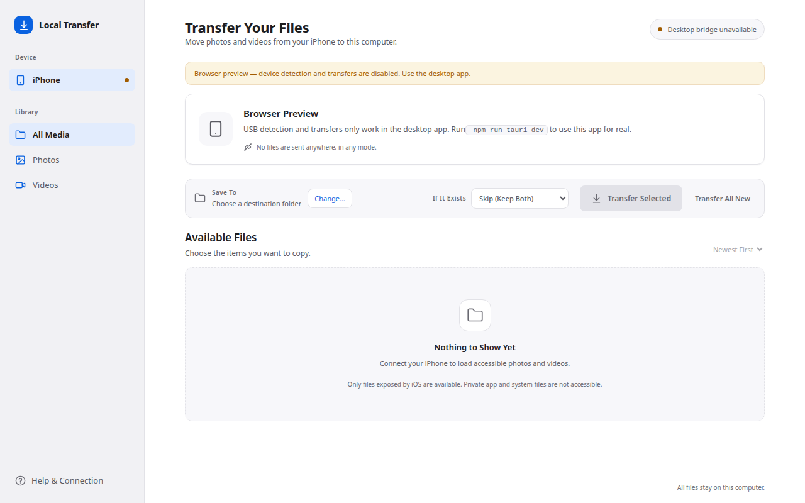
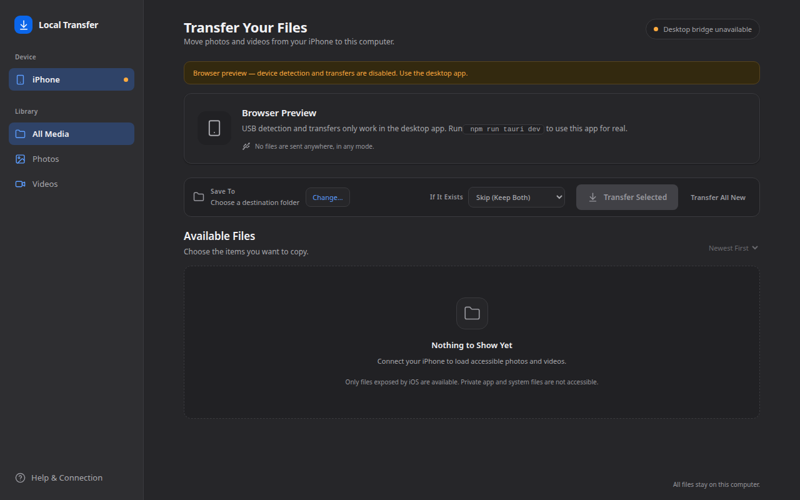

# Local iPhone Transfer

A local-only desktop app that copies accessible iPhone photos and videos to a folder on your computer over a USB cable.

Nothing leaves your machine: no server, no account, no telemetry, no network transfer of any kind. It is a file-copy utility, not a cloud service and not an iPhone backup tool.

[](https://github.com/chandanjainhp/iphone-local-transfer/releases/latest)
[](https://github.com/chandanjainhp/iphone-local-transfer/releases)
[](https://github.com/chandanjainhp/iphone-local-transfer/releases)
[](https://v2.tauri.app/)
[](https://vitejs.dev/)
[](#privacy-and-security)
[](#platform-support)

| Light | Dark |
| --- | --- |
|  |  |

---

## Table of contents

- [Download](#download)
- [Install on Linux](#install-on-linux)
- [First run](#first-run)
- [Using the app](#using-the-app)
- [Troubleshooting](#troubleshooting)
- [Privacy and security](#privacy-and-security)
- [Architecture](#architecture)
- [Project layout](#project-layout)
- [Transfer correctness policy](#transfer-correctness-policy)
- [Startup environment check](#startup-environment-check)
- [Develop from source](#develop-from-source)
- [Build and package a release](#build-and-package-a-release)
- [Quality gates](#quality-gates)
- [Platform support](#platform-support)
- [Current status and limitations](#current-status-and-limitations)
- [Roadmap](#roadmap)
- [Contributing](#contributing)
- [License](#license)

---

## Download

Every build is attached to a [GitHub Release](https://github.com/chandanjainhp/iphone-local-transfer/releases). The current release line is **`v0.1.0`** (Linux x86-64 only — see [Platform support](#platform-support)).

➡️ **[Open the latest release](https://github.com/chandanjainhp/iphone-local-transfer/releases/latest)** — or grab the artifact you need directly:

| Format | Download | Size |
| --- | --- | --- |
| Debian / Ubuntu | **[`Local.iPhone.Transfer_0.1.0_amd64.deb`](https://github.com/chandanjainhp/iphone-local-transfer/releases/download/v0.1.0/Local.iPhone.Transfer_0.1.0_amd64.deb)** | 3.2 MB |
| Fedora / RHEL | **[`Local.iPhone.Transfer-0.1.0-1.x86_64.rpm`](https://github.com/chandanjainhp/iphone-local-transfer/releases/download/v0.1.0/Local.iPhone.Transfer-0.1.0-1.x86_64.rpm)** | 3.2 MB |
| Any Linux distro | **[`Local.iPhone.Transfer_0.1.0_amd64.AppImage`](https://github.com/chandanjainhp/iphone-local-transfer/releases/download/v0.1.0/Local.iPhone.Transfer_0.1.0_amd64.AppImage)** | 100 MB |

```bash
# Debian / Ubuntu
sudo apt install ./Local.iPhone.Transfer_0.1.0_amd64.deb

# Fedora / RHEL
sudo dnf install ./Local.iPhone.Transfer-0.1.0-1.x86_64.rpm

# Any Linux distro (no install step, no root needed)
chmod +x ./Local.iPhone.Transfer_0.1.0_amd64.AppImage
./Local.iPhone.Transfer_0.1.0_amd64.AppImage
```

The `.deb` and `.rpm` declare `libimobiledevice-utils` and `usbmuxd` as package dependencies, so the distro package manager pulls in the USB tooling for you. The AppImage bundles everything it needs and is the largest download.

> Build outputs are named `Local iPhone Transfer_…` on disk. GitHub replaces the spaces with dots when uploading, which is why the release assets and the links above read `Local.iPhone.Transfer_…`.

## Install on Linux

1. Download one of the three artifacts above.
2. Install it with the matching command (or run the AppImage directly — no install step, no root).
3. Start **Local iPhone Transfer** from your application menu or from the terminal.

No Rust, Node.js, or developer tools are required on the machine running the app.

## First run

The app opens on a **setup screen** that checks every prerequisite and says, in plain language, exactly what is missing and how to fix it. You will see one of:

| Message | Meaning |
| --- | --- |
| *Preparing your iPhone connection…* | The environment check is still running. |
| *Your computer is ready.* | Connect and unlock the iPhone. |
| *USB support needs setup.* | The `libimobiledevice` tools are missing. The screen shows the exact copy-paste install command for your distro. |
| *iPhone connection service is not running.* | `usbmuxd` is stopped or unreachable. A stale socket counts as *stopped*, not as *missing*. |
| *Unlock your iPhone and approve the Trust prompt.* | Pairing is pending — unlock the phone and tap **Trust**. |
| *No iPhone detected.* | Connect a data-capable cable (not charge-only) and unlock the phone. |

Every screen offers **Check again** and a collapsed **Details for support** section with typed diagnostics — never raw stack traces. The app never installs anything, never starts a service, and never runs `sudo` on its own.

## Using the app

1. Connect the iPhone with a data-capable USB cable and unlock it.
2. Approve the **Trust This Computer?** prompt on the phone if it appears.
3. The app lists the photos and videos iOS itself exposes over USB. It does not claim access to the whole iOS filesystem.
4. Choose a destination folder with **Change…**.
5. Select individual files, use **Select All**, or use **Transfer All New**.
6. Watch per-file and overall progress, bytes copied, live speed, and an estimated time remaining.
7. The app finishes with a clear success summary or an actionable error, and tells you exactly which files were skipped.

Two more conveniences:

- **Previews** — the file list shows iOS-generated thumbnails when the phone provides them, and a plain icon placeholder when it does not. No image is ever invented.
- **Cancel** — the transfer stops safely at a chunk boundary; completed files are preserved and the active item is reported as interrupted, never as completed.

**Demo mode** (sidebar toggle) exercises the whole interface against a clearly labelled mock device when no iPhone is at hand. Demo data is always marked as such in the UI — no invented live values are ever shown in a normal session.

## Troubleshooting

| Symptom | What to do |
| --- | --- |
| Setup screen says the USB service is not running | Start `usbmuxd` with your service manager, e.g. `sudo systemctl start usbmuxd`, then click **Check again**. |
| Setup screen says tools are missing | Install `libimobiledevice` with your package manager (the screen shows the exact command). On Debian/Ubuntu, if `afcclient` is still missing, build it from the libimobiledevice sources (see the project site). |
| "Waiting for Trust approval" won't clear | Unlock the phone, keep it unlocked, and accept the Trust dialog. A fresh, data-capable cable helps. |
| iPhone detected but no files are listed | iOS exposes no files over AFC while iCloud Photos is set to **Optimize iPhone Storage** and the phone is locked. Keep the phone unlocked and check again. |
| Phone keeps disconnecting | Try another cable or port, and avoid USB hubs. The app marks interrupted files and never reports a partial copy as complete. |
| Destination files were skipped | A file with that name already exists. The default policy is **skip**; nothing is overwritten silently. |

## Privacy and security

- **All transfers stay local.** No telemetry, no analytics, no account, no cloud storage, and no network requests of any kind.
- **Source files are never deleted or modified.** The app only reads from the iPhone.
- **Only documented access paths are used.** The app does not bypass iOS pairing, the app sandbox, or any user-consent mechanism, and it shows a clear error rather than attempting private-filesystem access.
- **Filenames are treated as untrusted input** — path traversal is prevented and invalid destination characters are sanitised.
- **Command-line tools are invoked without a shell**, with fixed argument vectors and validated paths only.
- **No file contents and no sensitive full paths are logged by default.** Diagnostics contain typed status codes, not raw traces.

## Architecture

- **React 18 + TypeScript + Vite** — user interface ([src/App.tsx](src/App.tsx), typed backend bridge in [src/api.ts](src/api.ts))
- **Tauri 2 + Rust** — desktop shell and native orchestration
- **libimobiledevice command-line tools** (`idevice_id`, `ideviceinfo`, `idevicepair`, `afcclient`) — USB device detection, pairing state, and AFC file access
- **No application server, account system, analytics, cloud storage, or network transfer**

A narrow Rust `DeviceProvider` / `MediaSource` seam keeps platform-specific USB details out of the UI, so the whole interface can be exercised against a fake provider in tests.

Read [`AGENTS.md`](./AGENTS.md) before implementing features — it is the implementation brief and the acceptance criteria.

## Project layout

```
├── index.html                     Vite entry document
├── package.json                   npm scripts and JS dependencies
├── src/                           React + TypeScript frontend
│   ├── App.tsx                    top-level state machine and layout
│   ├── api.ts                     typed bridge to the Tauri commands
│   ├── types.ts                   shared DTOs and UI state types
│   ├── format.ts                  byte / duration / speed formatting
│   ├── previews.ts                thumbnail cache and decoding
│   ├── styles.css                 light + dark design tokens and all styles
│   └── components/                Sidebar, DeviceCard, DestinationToolbar,
│                                  FileList, FileRow, TransferProgress,
│                                  SetupScreen, dialogs
├── src-tauri/                     Rust native shell
│   ├── src/                       modules listed below
│   ├── icons/                     bundle icons
│   ├── capabilities/              Tauri 2 capability file
│   └── tauri.conf.json            window, bundle, and dependency config
├── docs/screenshots/              README screenshots
├── THIRD_PARTY_NOTICES.md         dependency license audit
└── AGENTS.md                      implementation brief and acceptance criteria
```

### Rust module layout (`src-tauri/src/`)

| Module | Responsibility |
| --- | --- |
| `device.rs` | Device model and the narrow `DeviceProvider` / `MediaSource` seam (fakes for tests) |
| `media.rs` | Media item DTOs, enumeration traits, source-path validation |
| `provider_libimobile.rs` | Real adapter: detection, pairing/Trust classification, AFC listing and reads |
| `provider_mock.rs` | Development-only mock adapter (explicitly labelled **demo** in the UI) |
| `transfer.rs` | Bounded-buffer copy, progress events, cancellation, conflict handling, partial-file policy |
| `progress.rs` | Rolling-window speed / ETA calculation (no invented values) |
| `preview.rs` | Thumbnail discovery and bounded preview payloads derived only from validated source paths |
| `naming.rs` | Filename sanitisation, path-traversal prevention, conflict resolution (skip/rename) |
| `errors.rs` | Stable UI-safe error codes and user-friendly messages |
| `platform.rs` | Platform-specific tool discovery and install hints |
| `environment.rs` | Startup prerequisite check with explicit states |
| `lib.rs` | Tauri commands, events, and application state |
| `main.rs` | Binary entry point |

### Native command surface

| Command | Purpose |
| --- | --- |
| `check_environment` | One-shot read-only prerequisite probe |
| `diagnostics` | Typed tool-discovery report for the setup screen |
| `get_device_status` | Latest device snapshot |
| `list_media` | Enumerate accessible photos and videos |
| `get_media_preview` | Fetch an iOS-generated thumbnail for one item |
| `pick_destination` | Native folder picker |
| `start_transfer` | Begin a transfer run |
| `cancel_transfer` | Request cancellation at the next chunk boundary |
| `set_mock_mode`, `set_mock_device_state` | Development-only demo controls (disabled in release builds) |

The backend streams progress back to the UI over two events: `device_status` and `transfer_event`.

## Transfer correctness policy

- Every file is copied to a hidden temporary file in the destination folder, flushed with `sync_all`, verified against the expected byte count, and only then published under its final name.
- On failure, cancellation, or USB disconnect the temporary file is deleted; the item is reported as failed or interrupted — **never** as completed.
- Destination name conflicts never silently overwrite. The default policy is **skip**; **rename** is optional.
- A bounded 1 MiB read buffer streams large files instead of loading them whole.
- Speed and ETA come from real samples over a moving window. The UI shows `—` / `Estimating…` until enough data exists.
- Source creation/modification times are preserved when the device reports them and the target filesystem can represent them. Missing dates are never invented.
- The UI stays responsive throughout: all native work runs off the main thread and reports through events.

## Startup environment check

`check_environment` (Rust: `environment.rs`) runs a read-only, one-shot probe in this order:

```
toolchain present  →  usbmuxd reachable  →  iPhone listed by idevice_id  →  trust verified
```

The usbmuxd step performs a real socket connect, so a stale socket is reported as *stopped*, not *missing*. Trust is verified with `idevicepair validate` and falls back to a direct lockdown query.

It returns one of these explicit states, plus a per-check list the setup screen renders:

`ready` · `device_not_connected` · `dependency_missing` · `service_not_running` · `permission_required` · `pairing_required` · `unsupported_platform` · `error`

The mock adapter is development-only; release builds refuse mock mode.

## Develop from source

### Prerequisites

Install Node.js LTS, Rust stable, and the Tauri v2 system prerequisites for your OS: <https://v2.tauri.app/start/prerequisites/>

Then install the libimobiledevice tools:

| Platform | Command |
| --- | --- |
| Linux (Arch) | `sudo pacman -S libimobiledevice` (provides `idevice_id`, `ideviceinfo`, `idevicepair`, `afcclient`) |
| Linux (Debian/Ubuntu) | `sudo apt install libimobiledevice-utils usbmuxd` (`afcclient` may need to be built from libimobiledevice sources on older releases) |
| Linux (Fedora) | `sudo dnf install libimobiledevice usbmuxd` |
| macOS | `brew install libimobiledevice` |
| Windows | not yet supported or validated — do not claim Windows support until tested with a real iPhone |

The app's **Help** panel, the `diagnostics` command, and the startup `check_environment` command all report which tools were found and how to install any that are missing.

### Run

```bash
npm install
npm run dev        # frontend only (browser preview — device features disabled)
npm run tauri dev  # full desktop app
```

The dev server listens on <http://localhost:1420> with `strictPort` enabled, so a second concurrent dev server will fail loudly rather than silently shifting ports.

## Build and package a release

```bash
npm run tauri build
```

Verified output on Linux x86-64:

| Artifact | Path | Size |
| --- | --- | --- |
| Release binary | `src-tauri/target/release/local-iphone-transfer` | 12 MB |
| Debian package | `src-tauri/target/release/bundle/deb/Local iPhone Transfer_0.1.0_amd64.deb` | 3.2 MB |
| RPM package | `src-tauri/target/release/bundle/rpm/Local iPhone Transfer-0.1.0-1.x86_64.rpm` | 3.2 MB |
| AppImage | `src-tauri/target/release/bundle/appimage/Local iPhone Transfer_0.1.0_amd64.AppImage` | 100 MB |

Packaging notes:

- The bundle icons are declared in `src-tauri/tauri.conf.json` (`bundle.icon`). Without them the AppImage step fails with *"couldn't find a square icon"*.
- The `.deb` and `.rpm` declare dependencies on the distribution's `libimobiledevice*` and `usbmuxd` packages instead of bundling third-party binaries, and ship `THIRD_PARTY_NOTICES.md` to `/usr/share/doc/local-iphone-transfer/`.
- The AppImage bundles the build host's libraries (see the licensing table in [`THIRD_PARTY_NOTICES.md`](./THIRD_PARTY_NOTICES.md)).
- Linux artifacts are unsigned; no code-signing infrastructure is configured.
- **macOS and Windows packaging is not configured or validated.**

### Publishing the release

The `v0.1.0` release is published, so the links in [Download](#download) resolve. To cut the next release:

```bash
git tag -a v0.1.1 -m "Local iPhone Transfer v0.1.1"
git push origin v0.1.1
cd src-tauri/target/release/bundle
gh release create v0.1.1 --verify-tag --title "v0.1.1" --notes-file <notes>.md \
  "deb/Local iPhone Transfer_0.1.1_amd64.deb" \
  "rpm/Local iPhone Transfer-0.1.1-1.x86_64.rpm" \
  "appimage/Local iPhone Transfer_0.1.1_amd64.AppImage"
```

**GitHub replaces spaces in uploaded asset names with dots**, so `Local iPhone Transfer_0.1.0_amd64.deb` becomes `Local.iPhone.Transfer_0.1.0_amd64.deb` on the release and in its download URL. Every download link in this README uses the dotted form. After publishing, verify the real asset names instead of assuming them:

```bash
gh release view v0.1.1 --json assets --jq '.assets[].name'
```

## Quality gates

```bash
npm run build                # tsc -b && vite build
cd src-tauri
cargo fmt --check
cargo clippy --all-targets   # 0 warnings
cargo test                   # 59 unit tests
```

Covered by unit tests: progress and speed calculation, ETA sample thresholds, filename conflict handling, path sanitisation, partial-file cleanup, cancellation, disconnect handling, and every startup-check state (dependency present/missing, service stopped vs. not installed, permission denied, device disconnected, pairing required, unsupported platform, malformed device response, tool present but not runnable).

## Platform support

| Platform | Detection | Listing | Transfer | Packaged | Notes |
| --- | --- | --- | --- | --- | --- |
| **Linux** | ✅ verified | ✅ verified | ✅ verified | ✅ deb / rpm / AppImage | Development and verification platform. |
| **macOS** | ⚠️ untested | ⚠️ untested | ⚠️ untested | ❌ not configured | Expected to work with Homebrew libimobiledevice; needs a physical iPhone to confirm. |
| **Windows** | ⚠️ untested | ⚠️ untested | ⚠️ untested | ❌ not configured | Do not claim support until tested with a real iPhone. |

## Current status and limitations

- Implemented and verified locally on **Linux**: detection, Trust/pairing states, media listing, streaming transfer with progress, previews, conflicts, cancellation, and disconnect handling (at unit level).
- **Physical-device validation on each target OS is still required** before claiming cross-platform readiness.
- iOS may expose no files over AFC when iCloud Photos is set to **Optimize iPhone Storage** and the phone is locked. The app reports this honestly instead of inventing content.
- iOS does not expose its entire filesystem. Only files iOS itself exposes over the supported services are listed; private app and system files are out of scope.
- macOS and Windows builds are not produced yet, and there is no CI pipeline or automated release workflow.
- Cancellation and disconnect are handled per item, but resuming an interrupted transfer is not guaranteed.

## Roadmap

Explicitly out of scope for v1, in rough order of likely value:

- Physical-device validation on macOS and Windows, then signed installers for both.
- A GitHub Actions workflow that builds and attaches the three Linux artifacts automatically on every tag.
- Optional content-comparison for same-named destination files (today the app only handles name conflicts and never claims two same-named files are identical).
- Computer-to-iPhone transfer, once supported destinations and their UX are validated.
- Resume across a disconnect, where the underlying protocol can support it.

## Contributing

1. Read [`AGENTS.md`](./AGENTS.md) — it is the binding brief, and it lists what is deliberately out of scope for v1.
2. Keep the `DeviceProvider` / `MediaSource` seam intact so everything stays testable without a physical phone.
3. Run the [quality gates](#quality-gates) before opening a pull request.
4. Label any mock or demo data explicitly. Never invent live values.
5. Test with a physical iPhone before claiming a new platform works.

## License

This project does not declare an application license yet — a `LICENSE` file has not been added, so all rights are reserved by the authors until one is chosen.

Third-party dependencies and how they are shipped:

- Bundled Rust crates are MIT / Apache-2.0.
- `libimobiledevice` (LGPL-2.1) and `usbmuxd` (GPL-2.0) are invoked as user-installed programs and are never bundled or modified.

Full audit: [`THIRD_PARTY_NOTICES.md`](./THIRD_PARTY_NOTICES.md).
